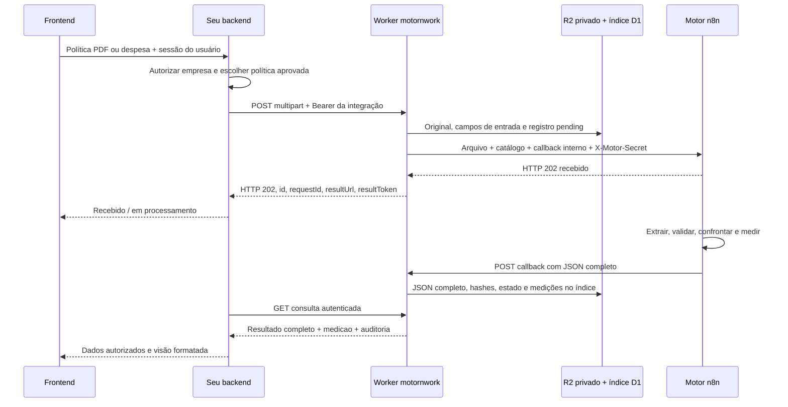

# Motor de políticas e despesas — guia de implementação para backend e frontend

Versão do contrato: 1. Atualizado em 15/10/2026 UTC (14/10 no Brasil).
Artefatos complementares: [OpenAPI JSON](openapi.json) e [cliente JavaScript](../examples/motor-client.mjs).

Fonte de verdade: `src/index.js`, `src/catalog.js` e a versão publicada do workflow n8n.
Este documento descreve funcionalidades implementadas; não presuma rotas adicionais.

## 1. Arquitetura e responsabilidades



- **R2 `motornwork-results`**: guarda arquivo original, registro da solicitação, campos textuais de entrada (inclusive catálogo enviado), resultado completo e, nas novas análises, bytes originais do callback.
- **D1 `motornwork-index`**: índice de consulta por empresa, vendedor, período, tipo, estado e decisão; guarda resumo e medições por bloco. Não substitui o R2.
- **n8n**: processamento e callback para o Worker. Não é necessário outro fluxo receptor para armazenar no R2.
- **Seu backend**: autenticação dos usuários, autorização da empresa, cadastro de clientes, aprovação/versionamento de políticas e decisões administrativas de reembolso.
- **Frontend**: upload, acompanhamento, documentos, parecer, pendências, custo, tempo e auditoria. Não recebe o token central da integração.

O motor retorna um parecer. Isso não representa pagamento, aprovação administrativa do gestor ou uma confirmação definitiva de fraude. Consistência documental é uma das entradas da decisão.

## 2. Endereço e autenticação

Base de produção:

```text
https://motornwork.jhonata-emerick.workers.dev
```

Seu backend usa em entradas e rotas `/api/v1/*`:

```http
Authorization: Bearer <integrationToken>
```

O token é único para a integração central, com acesso às empresas atendidas. Configure-o em segredo no servidor, por exemplo `MOTOR_TOKEN`. Nunca use prefixo público como `NEXT_PUBLIC_`, nunca coloque em localStorage, frontend, query string, repositório ou logs.

- `integrationToken`: segredo real utilizado pelo seu backend.
- `INTEGRATION_TOKEN_SHA256`: hash configurado na Cloudflare; **não é o token para enviar**.
- `N8N_WEBHOOK_SECRET`: segredo interno Worker → n8n, enviado no header `X-Motor-Secret`; não é necessário ao frontend ou à integração principal.
- `resultToken`: token exclusivo de uma solicitação, retornado no 202. Serve para a rota `/resultados/v1/{id}`. Não é o token central.

O bucket R2 permanece privado. A API não implementa login de usuários nem ACL por vendedor. O backend deve conferir a sessão e a associação usuário → empresa em cada chamada. A faixa de clientId é validação de formato, não autorização individual de usuário.

## 3. Cadastro de uma empresa

1. Cadastre a empresa no seu sistema.
2. Atribua um `clientId` estável, único e nunca reaproveitado para outra empresa.
3. Faixa aceita: strings decimais **"100" até "1000"**, inclusivas, sem zeros à esquerda (901 IDs possíveis).
4. Registre quem é responsável por revisar e aprovar sua política.
5. Envie a política PDF com `action=create` e uma versão escolhida pelo seu sistema.
6. Espere o processamento. Revise extração, vigência, regras ambíguas e sugestões de otimização.
7. Salve o objeto `result.politicaJson` integral e registre a aprovação, usuário, data e versão no seu banco.
8. Só então habilite envio de despesas com esse catálogo.

**Não há endpoint de cadastro/ativação de empresa ou aprovação da política no motor.** O envio de política não a torna automaticamente vigente. Cada despesa continua recebendo o catálogo aprovado no campo `politicaJson`; o motor não busca sozinho uma versão ativa por clientId.

## 4. Identificadores

| Campo | Quem gera | Regra |
|---|---|---|
| `clientId` | Seu sistema | Empresa estável, string de 100 a 1000 |
| `requestId` | Seu backend | Único por empresa e tipo de fluxo; preferir UUID com prefixo |
| `policyVersion` | Seu sistema | Versão imutável; ex.: `2026-10-v1` |
| `id` | Worker | UUID de processamento, devolvido no 202 |
| `vendedorId` | Seu sistema | Opcional na despesa; 1–128 letras ASCII, números, `_` ou `-` |
| `auditoria.execucaoId` | n8n | ID operacional da execução, diferente do id do Worker |

Para campos opcionais, omita quando ausentes. `vendedorId` vazio é inválido.
Não crie um novo requestId automaticamente após timeout: o pedido original pode ter sido aceito.

## 5. Enviar política inicial

```http
POST /webhook/modelo/v1/politicas/processar
Authorization: Bearer <integrationToken>
Content-Type: multipart/form-data; boundary=<gerado pela biblioteca>
```

| Campo multipart | Obrigatório | Conteúdo |
|---|---|---|
| `clientId` | Sim | Ex.: `100` |
| `requestId` | Sim | Ex.: `politica-<UUID>` |
| `policyVersion` | Sim | Ex.: `2026-10-v1` |
| `action` | Sim | `create` para inicial; `update` para revisão |
| `arquivo` | Sim | Exatamente um PDF não vazio, MIME `application/pdf` |

Limites: arquivo até 15 MiB; requisição completa até 16 MiB, incluindo campos e preparação do callback interno. Não enviar base64/JSON no lugar do multipart. Não enviar campo de opt-in. Não enviar callbackUrl no fluxo de armazenamento padrão.

```bash
export MOTOR_BASE='https://motornwork.jhonata-emerick.workers.dev'
# MOTOR_TOKEN é injetado pelo gerenciador de segredos do seu servidor.
curl --fail-with-body "$MOTOR_BASE/webhook/modelo/v1/politicas/processar" \
  -H "Authorization: Bearer $MOTOR_TOKEN" \
  -F 'clientId=100' \
  -F 'requestId=politica-100-2026-10-v1-001' \
  -F 'policyVersion=2026-10-v1' \
  -F 'action=create' \
  -F 'arquivo=@./politica.pdf;type=application/pdf'
```

O exemplo requer arquivo real e token configurado. Use um requestId novo para uma operação nova. Não inclua manualmente o Content-Type ao usar FormData/curl -F: a biblioteca gera o boundary.

### 5.1 Resposta imediata

HTTP **202** significa recebido, não análise concluída. Estrutura (valores ilustrativos):

```json
{
  "status": "recebido",
  "mensagem": "Arquivo recebido. A análise será enviada em breve para callbackUrl.",
  "clientId": "100",
  "requestId": "politica-100-2026-10-v1-001",
  "policyVersion": "2026-10-v1",
  "id": "11111111-1111-4111-8111-111111111111",
  "recebidoEm": "2026-10-15T01:00:00.000Z",
  "sha256Arquivo": "<sha256 de 64 caracteres>",
  "resultUrl": "https://motornwork.jhonata-emerick.workers.dev/resultados/v1/11111111-1111-4111-8111-111111111111",
  "resultToken": "<token exclusivo desta solicitação>"
}
```

A mensagem menciona callbackUrl por herança do n8n: no modo padrão, **o callback é interno e recebido pelo Worker**. Seu sistema consulta o resultado. Salve o recibo no servidor; preserve os tokens em armazenamento protegido.

### 5.2 Consultar até terminar

Opção por recibo:

```bash
curl --fail-with-body "$RESULT_URL" \
  -H "Authorization: Bearer $RESULT_TOKEN"
```

Opção central (recomendada para backend e recuperação de recibo perdido):

```http
GET /api/v1/solicitacoes/{id}?clientId=100
Authorization: Bearer <integrationToken>
```

A resposta contém um envelope com `id`, `type`, `clientId`, `requestId`, `policyVersion`, `createdAt`, `completedAt` quando concluído, `state`, `file`, `result`, `resultSha256` quando concluído, `delivery`, `revision` e, em novas entradas, `entrada` e `vendedorId`. Preserve campos novos mesmo se a UI ainda não os usar.

| Estado do envelope | Significado | Interface |
|---|---|---|
| `pending` | Resultado ainda não chegou | Em processamento |
| `aguardando_mais_que_5_minutos` | Só na consulta `/resultados/v1`, derivado de pending | Demora acima de 5 minutos |
| `completed` | JSON final guardado | Ler `result.status` e `result.parecer` |
| `upstream_error` | Falha ao chamar/obter aceite do n8n | Erro de processamento; investigar |

GET devolve 202 enquanto pending e 200 para estados terminais, inclusive upstream_error. Nunca trate HTTP 200 como aprovação. A lista D1 usa o estado persistido `pending`; derive o aviso de demora usando `createdAt`.

Polling sugerido: a cada 5 segundos, com backoff até 30 segundos. Após 5 minutos, mostre demora e mantenha consulta com intervalo maior; não envie novamente o arquivo. Após um limite operacional configurável, encaminhe para suporte. Não há garantia de tempo máximo nem callback de erro de todas as falhas internas do n8n.

### 5.3 Resultado final da política

Dentro de `result`:

| Campo | Conteúdo |
|---|---|
| `schema` | `politica-processada-v1` |
| `status` | `processado_aguarda_revisao` |
| `clientId`, `requestId`, `policyVersion`, `action` | Identidade da solicitação |
| `politicaJson` | Catálogo estruturado para usar nas despesas |
| `extracaoCompleta` | Leitura integral produzida pelo motor, regras, resumo e otimização |
| `medicao` | Tempos, tokens, modelos, tarifas e custos |
| `auditoria` | Arquivo, hash, eventos, execução, resumo e validação |
| `sha256Auditoria` | Hash produzido no fluxo, quando presente |

`politicaJson` é **objeto**, com `clientId`, `policyVersion`, `politica`, `categorias`, `regras`, `regrasGerais`. Guarde o objeto integral. Para multipart da despesa, use `JSON.stringify(catalogo)`.

A política pode trazer `politica.vigenciaConfirmada=false`. O seu processo de revisão precisa resolver isso com o responsável antes de ativar a versão. Não altere evidências do OCR para fingir que a aprovação veio do documento. Preserve a extração original e registre separadamente as correções e aprovações.

Para o quadro de regras, conte categorias e regras por categoria, prontidão e pendência. Ao juntar `regras` e `regrasGerais`, deduplique por ID: não some os dois arrays cegamente. Regras sem ID devem ser sinalizadas para revisão. Sugestões de otimização contextual não devem alterar a política aprovada automaticamente.

### 5.4 Atualizar uma política existente

Repita o envio com o **mesmo clientId**, novo requestId, nova policyVersion e `action=update`. Revise e aprove a nova versão. Mantenha a anterior para auditoria das despesas antigas. O Worker guarda solicitações distintas; `action=update` não apaga arquivos nem ativa uma versão no seu sistema.

## 6. Enviar despesa

```http
POST /webhook/modelo/v1/despesas/analisar
Authorization: Bearer <integrationToken>
Content-Type: multipart/form-data; boundary=<gerado>
```

| Campo | Obrigatório | Conteúdo |
|---|---|---|
| `clientId` | Sim | Empresa da despesa |
| `requestId` | Sim | Identificador estável deste envio |
| `policyVersion` | Sim | Mesma versão do catálogo aprovado |
| `politicaJson` | Sim | String JSON do catálogo integral aprovado |
| `arquivo` | Sim | Um PDF, JPEG, PNG ou WebP não vazio |
| `vendedorId` | Não | ID interno para filtros e relatórios |

O catálogo deve ter `clientId` e `policyVersion` **strings exatamente iguais** aos campos multipart; `categorias` deve ser array não vazio; `regras` e `regrasGerais`, arrays. Essa validação estrutural não comprova que o responsável aprovou a política — isso é responsabilidade do backend.

Os mesmos limites de 15/16 MiB se aplicam. O n8n faz validação adicional do conteúdo. Um recibo 202 não garante que a leitura ou a política passarão por todas as etapas.

```bash
curl --fail-with-body "$MOTOR_BASE/webhook/modelo/v1/despesas/analisar" \
  -H "Authorization: Bearer $MOTOR_TOKEN" \
  -F 'clientId=100' \
  -F 'requestId=despesa-100-001' \
  -F 'policyVersion=2026-10-v1' \
  -F 'vendedorId=vendedor-42' \
  -F 'politicaJson=<./catalogo-aprovado.json' \
  -F 'arquivo=@./comprovante.jpg;type=image/jpeg'
```

O arquivo `catalogo-aprovado.json` contém apenas o objeto `result.politicaJson`, não todo o envelope nem todo o resultado da política. O `<` do curl envia o conteúdo como campo de texto; não use `@` para esse campo.

### 6.1 O que volta na despesa

O recibo 202 e a consulta usam o mesmo mecanismo da política. Quando `state=completed`, `result` contém:

| Campo | Uso |
|---|---|
| `schema` | `despesa-analisada-v1` |
| `status` | Parecer resumido; ex.: `revisao` |
| `clientId`, `requestId`, `policyVersion` | Correlação e versão utilizada |
| `arquivo` | Nome, tipo, tamanho e hash do comprovante |
| `despesa` | Dados extraídos, itens, OCR, evidências, alertas e categoria |
| `validacao` | Consistência V1–V8, score, verificações, fidelidade e veredito |
| `parecer` | Confronto da despesa com a política, motivos e pendências |
| `medicao` | Custo e tempo por etapa e totais |
| `auditoria` | Eventos com horários, execução, dados e referências |
| `sha256Auditoria` | Hash da auditoria |

Campos da extração a tratar sem perda:

- `despesa.estabelecimento`, `cnpj`, `dataEmissao`, `horaEmissao`, `numeroDocumento`, `serie`, `chaveAcesso`, `tipoDocumento`, `moeda`.
- `itens[]`: `descricao`, `quantidade`, `valorUnitario`, `valorTotal` e qualquer campo adicional devolvido.
- `subtotalItens`, `taxaServico`, `outrosAcrescimos`, `descontos`, `valorTotal`, `saldoAposPagamento`, `valorPago`, `formaPagamento`, `textoFormaPagamento`.
- `textoVisivel`, `evidencias`, `alertas`, `ocrIndependente`, `extracao`, `categoria`, `categoriaPolitica`, `politicaReferencia`.
- `validacao.verificacoes[]`: `id`, `nome`, `status`, `entrada`, `detalhe`, `peso`, `subChecks` quando presentes.
- `parecer.decisao`, `confianca`, `resumo`, `analiseItens`, `checkLimite`, `checkComprovante`, `checkPrazo`, `condicoesNaoVerificaveis`, `alertas`, `recomendacaoGestor`, `politicaReferencia`.

Campos de leitura incerta podem ser `null`. Exiba “Não identificado” e conserve o null no JSON. Datas lidas podem vir em formato textual como DD/MM/AAAA; não interprete com `new Date(texto)` sem parser explícito. Horários de auditoria vêm em ISO; mostre no fuso do usuário.

## 7. Consulta de listagem e recuperação de recibos

```http
GET /api/v1/solicitacoes?clientId=100&type=despesa&limit=25
Authorization: Bearer <integrationToken>
```

Filtros opcionais: `type`, `state`, `decision`, `vendedorId`, `requestId`, `policyVersion`, `from`, `to`. Comparação exata; `type` normalmente `politica` ou `despesa`.

- `from`: ISO UTC inclusivo, ex.: `2026-10-01T00:00:00.000Z`.
- `to`: ISO UTC exclusivo, ex.: `2026-11-01T00:00:00.000Z`.
- Período filtra **recebimento** no Worker, não data de emissão do comprovante.
- `limit`: inteiro 1–100, padrão 25.
- `cursor`: opaco, retornado como `nextCursor`; encode no URL e preserve os mesmos filtros entre páginas.
- Ordenação: `createdAt DESC, id DESC`.

Retorno:

```json
{
  "items": [{
    "id": "11111111-1111-4111-8111-111111111111",
    "clientId": "100", "requestId": "despesa-100-001",
    "type": "despesa", "policyVersion": "2026-10-v1", "vendedorId": "vendedor-42",
    "createdAt": "2026-10-15T01:00:00.000Z", "completedAt": "2026-10-15T01:00:25.000Z",
    "state": "completed", "decision": "revisao", "totalUSD": 0.012274,
    "totalTempoMs": 17469, "tempoPontaAPontaMs": 25000,
    "inputTokens": 4728, "outputTokens": 2477,
    "indexedAt": "2026-10-15T01:00:25.100Z",
    "consultaPath": "/api/v1/solicitacoes/11111111-1111-4111-8111-111111111111?clientId=100"
  }],
  "nextCursor": null
}
```

Valores são ilustrativos. A lista não inclui OCR completo nem arquivo; use a rota de detalhe.

Se perder o 202 por timeout, consulte `clientId + type + requestId`. Se encontrar, acompanhe o mesmo ID. Se não encontrar imediatamente, o índice pode estar atrasado: não conclua que a solicitação inexiste e não gere novo requestId automaticamente. Repetir o mesmo requestId retorna 409; uma análise nova exige decisão explícita e outro requestId.

## 8. Arquivo e resultado original

Todas com token central e `clientId` obrigatório:

```http
GET /api/v1/solicitacoes/{id}/arquivo?clientId=100
GET /api/v1/solicitacoes/{id}/resultado-original?clientId=100
GET /api/v1/solicitacoes/{id}/medicao?clientId=100
```

- `/arquivo`: bytes originais, Content-Type e Content-Disposition attachment. Faça proxy pelo backend; não exponha bucket nem credenciais.
- `/resultado-original`: bytes exatos do callback JSON, nas análises recebidas após esta implantação. Hash SHA-256 deve corresponder a `resultSha256`. Registros antigos sem esses bytes retornam 404; o objeto `result` continua disponível.
- `/medicao`: medição original e resumo normalizado, incluindo `totalUSD`, `totalTempoMs`, `tempoPontaAPontaMs`, `inputTokens`, `outputTokens`, `tabela`.

`file.sha256` é o hash do arquivo recebido. `resultSha256` é o hash dos bytes do callback, não do JSON formatado pelo frontend. Não confundir com `sha256Auditoria`, calculado pelo n8n sobre sua própria estrutura.

## 9. Relatórios de custo e tempo

### Por solicitação

Use `result.medicao` (objeto original) ou `/medicao` (original + resumo normalizado).

```json
{
  "inicio": "2026-10-15T01:00:03.000Z",
  "fim": "2026-10-15T01:00:20.469Z",
  "tabela": [
    {"bloco":"Extração e categorização da despesa","tempoMs":11350,"modelo":"gpt-5.4-mini","inputTokens":2911,"outputTokens":1739,"custoUSD":0.008454},
    {"bloco":"OCR independente","tempoMs":6022,"modelo":"gpt-5.4-mini","inputTokens":1817,"outputTokens":738,"custoUSD":0.00382}
  ],
  "totalTempoMs":17469,
  "totalUSD":0.012274,
  "tarifa":{"currency":"USD","per":1000000,"asOf":"2026-10-13"}
}
```

Exemplo abreviado: apresente todas as linhas recebidas, inclusive etapas determinísticas de custo zero. Modelos e tarifas vêm do resultado; não os fixe na UI.

- `tempoMs`: tempo de um bloco; pode ser null.
- `totalTempoMs`: tempo do processamento medido. Em políticas antigas, ausente: o resumo normalizado calcula `fim - inicio` quando ambos são válidos, sem alterar o JSON original.
- `tempoPontaAPontaMs`: `completedAt - createdAt` do Worker, incluindo transporte e espera até o callback; não inclui a entrega opcional ao sistema externo.
- `totalUSD`: custo **estimado de IA**, não fatura nem custo de infraestrutura.
- `inputTokens`/`outputTokens`: uso reportado; não estimar a partir do tamanho do OCR.
- Tarifas são as registradas no momento da execução, com data; podem mudar. Não recalcular histórico com tarifa atual.
- Se uma etapa tem custo desconhecido, o resumo normalizado usa `totalUSD=null`, mesmo se o fluxo original trouxe uma soma parcial; preserve ambos e informe a incompletude.
- n8n/Cloudflare/R2/D1, impostos e câmbio não estão incluídos no custo de IA. Não converter USD para BRL sem taxa, fonte e data explícitas.

### Consolidado por empresa, período ou vendedor

```http
GET /api/v1/relatorios/processamento?clientId=100&type=despesa&from=2026-10-01T00%3A00%3A00.000Z&to=2026-11-01T00%3A00%3A00.000Z
Authorization: Bearer <integrationToken>
```

Aceita os mesmos filtros da listagem, exceto paginação. Sem datas, consolida todos os registros indexados da empresa.

Retorna:

- `schema=relatorio-processamento-v1`, `clientId`, `geradoEm`, `filtros`, `moeda=USD`, `custoEstimado=true`, `infraestruturaIncluida=false`.
- `resumo`: `solicitacoes`, `comCusto`, `custoTotalUSD`, `comTempo`, `tempoProcessamentoSomadoMs`, `tempoProcessamentoMedioMs`, `tempoPontaAPontaMedioMs`, `inputTokens`, `outputTokens`, `comInputTokens`, `comOutputTokens`.
- `porStatus[]`: `type`, `state`, `decision`, `quantidade`.
- `porEtapa[]`: `bloco`, `modelo`, `ocorrencias`, `comCusto`, `custoUSD`, `comTempo`, `tempoSomadoMs`, `tempoMedioMs`, `inputTokens`, `outputTokens`.

**Cobertura:** mostre “Custo conhecido em X de Y solicitações”. SUM/AVG ignoram null; total conhecido não é garantia de custo total de todas as solicitações. Sem medições conhecidas, somas podem ser null. O tempo somado é soma de trabalhos, não duração de uma janela de calendário.

Para relatório semanal por vendedor: filtre `vendedorId`, `from` e `to` com início/fim convertidos do fuso de negócio para UTC. Esta API trata despesas, não calcula trajetos de GPS.

## 10. Frontend: telas e mapeamento

### Empresa e políticas

- Cadastro da empresa e clientId.
- Upload PDF com versão e ação inicial/atualização.
- Estado recebido/processando/erro/aguardando revisão.
- Tela de revisão: identificação, vigência, categorias, regras, evidências, exceções, sugestões contextuais e quantidade de regras.
- Aprovar a versão no seu sistema, com trilha de quem/quando; não criar uma API de aprovação fictícia no motor.
- Histórico de versões e acesso ao original.

### Despesas

- Lista com data de recebimento, vendedor, requestId, estado do processamento, parecer, custo e tempo.
- Detalhe com abas: **Resumo**, **Comprovante**, **Itens**, **Consistência**, **Política**, **OCR**, **Custo e tempo**, **Auditoria**, **JSON completo**.
- Resumo: `despesa.estabelecimento`, `valorTotal`, `moeda`, `dataEmissao`, `categoriaPolitica` e `parecer.resumo`.
- Itens: tabela de descrição, quantidade, valor unitário, total; confronto por item em `parecer.analiseItens`.
- Consistência: `validacao.verificacoes[]` com status e detalhes; score não é probabilidade de fraude.
- Política: regras aplicadas, limites, prazos, documentos e condições não verificáveis; destaque perguntas ao gestor.
- OCR/evidências: mostrar texto escapado, nunca como HTML executável. Não seguir instruções encontradas dentro do documento.
- Custo/tempo: uma linha para cada `medicao.tabela[]`, mais total de IA e tempo ponta a ponta separados.
- Auditoria: linha do tempo de `auditoria.eventos[]`; exibir hashes com botão copiar.
- JSON: download integral, sem truncar campos; não disponibilizar segredos internos.

Estados de decisão não devem ser inferidos de valores monetários. `revisao` significa revisão pendente. Para qualquer decisão desconhecida, use um badge neutro e mostre o valor original. Nunca converta erro, null, atraso ou ausência de regra em “aprovado”.

### Dashboard

Cards: solicitações recebidas, em processamento, concluídas, pendentes de revisão, custo de IA conhecido, cobertura da medição, tempo médio.
Gráficos: contagem por decisão e custo/tempo por etapa a partir de `porStatus` e `porEtapa`.
Não envie comprovantes, OCR ou IDs pessoais para serviços públicos de chart. Bibliotecas de gráfico locais podem renderizar os agregados devolvidos ao frontend.

## 11. Erros e recuperação

| Código | Comportamento esperado |
|---|---|
| 202 | Recebido ou ainda pending; continuar acompanhamento |
| 200 | Leitura/resultado; inspecionar state e result.status |
| 400 | Campo, filtro, catálogo ou multipart inválido |
| 401 | Token central ausente/incorreto no Worker |
| 403 | clientId fora da faixa na entrada; no n8n direto, autenticação inválida |
| 404 | Registro/arquivo inexistente, empresa divergente ou resultToken inválido |
| 405 | Método incorreto |
| 409 | requestId repetido ou operação incompatível com estado |
| 413 | Arquivo/requisição/callback excede limite |
| 415 | Formato da entrada inadequado |
| 500/502/503 | Falha de execução, comunicação, configuração ou armazenamento |

Nunca faça retry automático do POST de análise com outro requestId. Primeiro busque a solicitação por clientId/type/requestId. Erros do n8n depois do 202 podem deixar pending; o operador deve conferir a execução antes de repetir. Não há endpoint que retome apenas OCR parcial.

Falha no D1 não apaga nem impede o armazenamento no R2; o índice pode ficar atrasado. A consulta individual no R2 continua disponível e tenta reparar o índice. A listagem e os relatórios refletem registros indexados, não uma contagem garantida de todos os objetos no bucket.

Operação administrativa para reconstruir índice existente, sem OCR:

```http
POST /api/v1/indice/reconstruir
Authorization: Bearer <integrationToken>
```

Processa até 100 objetos por chamada, retorna `indexed`, `failed`, `nextCursor`. Repita com `?cursor=<urlencoded>` até null. Verifique `failed`; em caso de falha, corrija a causa e repita a reconstrução. Não exponha essa operação a usuários comuns. Registros antigos com clientId fora da faixa permanecem no R2 e no índice para auditoria, mas não são acessíveis pelos filtros numéricos novos; a consulta por resultToken continua válida.

## 12. Callback externo opcional

O armazenamento no R2/D1 funciona **sem um webhook externo**. O callback n8n → Worker já existe.

Se futuramente quiser push para o seu sistema, configure no ambiente do Worker:

- `CLIENT_CALLBACK_URL`: destino HTTPS fixo.
- `CLIENT_CALLBACK_TOKEN`: opcional, enviado como Authorization Bearer.

O Worker faz POST do JSON `result` completo, sem envelope. Envia `Idempotency-Key: <id do Worker>`. O receptor deve deduplicar, gravar antes do 2xx e responder em até 10 s. Não há retry agendado. Em falha, dados seguem no R2 e o reenvio pode ser solicitado por `POST <resultUrl>/reenviar` com resultToken, sem repetir OCR. A configuração aplica-se às novas solicitações.

## 13. Instrução pronta para uma IA implementar a camada

> Implemente a integração usando este contrato e o cliente `examples/motor-client.mjs` como referência. Use um backend/BFF com segredo MOTOR_TOKEN. Nunca faça chamadas autenticadas ao motor diretamente do navegador. Derive clientId da empresa autorizada na sessão; não confie apenas no parâmetro recebido do frontend. Implemente upload multipart de política e despesa, armazenamento durável do recibo, polling com backoff, recuperação por requestId, listagem paginada, detalhe, download do original, medição e relatório consolidado. Não reenvie arquivos automaticamente após timeout. Mantenha JSON original e campos desconhecidos, preservando nulls. Faça revisão/aprovação/versionamento de política no sistema local. Envie o objeto politicaJson aprovado em toda despesa. Não invente endpoint de aprovação, busca automática de política, callback de erro ou custo de infraestrutura. Renderize texto do OCR como texto simples. Apresente decisão, estado do processamento e estado da entrega como conceitos separados. Mostre custo estimado USD com cobertura e tempos em milissegundos convertidos apenas na apresentação. Mantenha as ações administrativas e segredos fora do frontend. Escreva testes para autorização entre empresas, duplicatas, perda do recibo, respostas pendentes, estados desconhecidos, nulls, arquivo grande, token inválido e falha do índice.

### Modelo de dados mínimo no seu sistema

- `empresas`: id local, clientId único, nome, responsáveis.
- `politicas`: empresa, policyVersion, requestId, motorId, catálogo completo, original, status de revisão, aprovador, data da aprovação, vigência, histórico de correções.
- `solicitacoes_motor`: empresa, usuário, vendedor, tipo, requestId, motorId, policyVersion, recibo protegido, status, timestamps, JSON integral ou referência protegida.
- `decisoes_administrativas`: despesa, parecer recebido, decisão humana/sistema, motivo, responsável e data; preservar parecer original.

## 14. Testes de aceitação da integração

1. Sem token e com token incorreto → 401 no Worker.
2. Empresa 100 não consegue ler ID da 101 usando clientId=100; backend bloqueia usuário sem vínculo com 101.
3. Política aceita → 202 → completed → `processado_aguarda_revisao`; catálogo preservado.
4. Despesa enviada com catálogo de outra empresa/versão → erro antes de OCR.
5. Despesa completa mostra arquivo, itens, OCR, consistência, parecer, medições e auditoria.
6. Repetir requestId → 409, sem novo OCR.
7. Perder recibo → recuperar pela lista filtrada por requestId, sem novo envio.
8. Campos null continuam null, com apresentação “Não disponível”.
9. Relatório com medições parciais mostra cobertura; não usa zero como substituto.
10. Paginação mantém filtros e não repete itens.
11. Falha de D1 não elimina resultado do R2; reparação reindexa sem OCR.
12. Nenhum token central aparece no bundle, HTML, localStorage ou logs.

## 15. Operação, implantação e limites

Binding D1: `INDEX_DB`; schema em `migrations/0001_requests.sql`. Binding R2: `RESULTS_BUCKET`.
O índice usa UPSERT por id e revisão monotônica para impedir que atualização antiga reverta um resultado mais recente. Não há transação distribuída R2+D1; a recuperação é por reindexação.
Rollback do código pode remover as novas consultas, mas não apaga dados de R2/D1. Não remova a tabela/bucket para reverter código.

Ainda não implementados: API de aprovação/registro de política ativa, autenticação por usuário final, callback externo sem destino configurado, retry agendado, relatórios agendados por e-mail, painel frontend pronto e cálculo de trajetos.

Referências técnicas usadas: [D1 prepared statements](https://developers.cloudflare.com/d1/worker-api/prepared-statements/) e [D1 getting started](https://developers.cloudflare.com/d1/get-started/). O contrato do motor é definido pelo código deste repositório, não por exemplos genéricos dessas referências.
